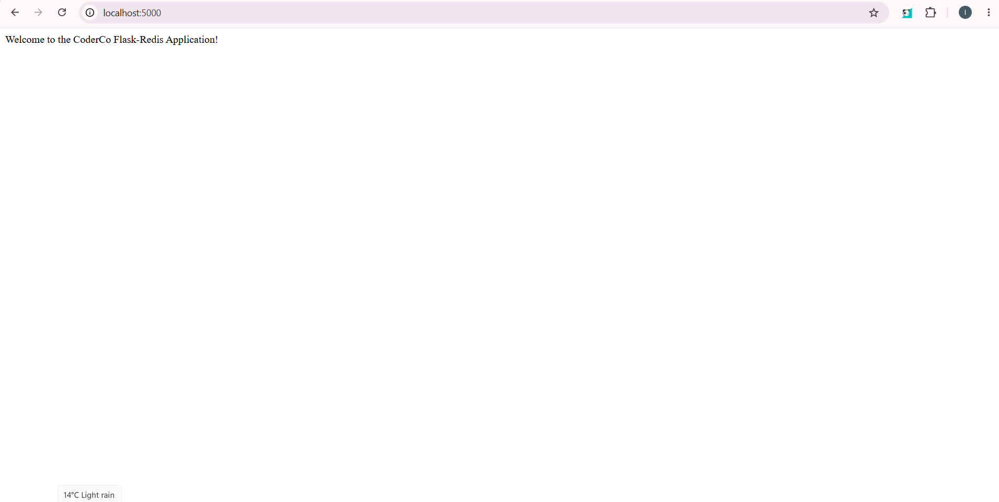
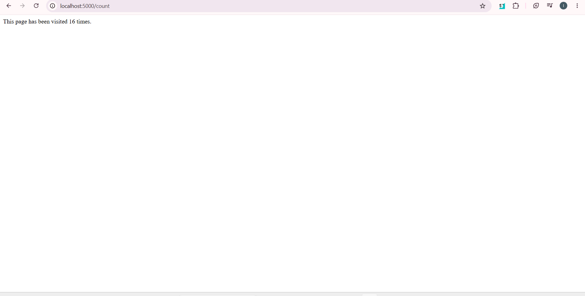

#  Multi-Container Microservices Architecture: Flask & Redis with Docker Compose

A hands-on DevOps containerization project demonstrating how to build, package, and orchestrate a multi-container web application using **Python Flask**, **Redis**, **Docker**, and **Docker Compose**.

---

##  Architecture & Workflow

```text
[ Browser / Client ]
         │
  ( Port 5000:5000 )
         ▼
┌──────────────────────────────────────────────────────────┐
│ Docker Network Bridge                                    │
│                                                          │
│   ┌─────────────────────┐      ( Port 6379 )             │
│   │  Flask Web App      │─────────────────────┐          │
│   │  Container          │                     ▼          │
│   │  (Service: web)     │           ┌──────────────────┐ │
│   └─────────────────────┘           │  Redis DB        │ │
│                                     │  Container       │ │
│                                     │  (Service: redis)│ │
│                                     └──────────────────┘ │
└──────────────────────────────────────────────────────────┘
```

---

##  Technologies Used

* **Container Runtime & Orchestration:** Docker Engine, Docker Compose
* **Programming Language & Framework:** Python 3.11, Flask
* **Database & In-Memory Store:** Redis 7 (Alpine)

---

##  What I Built

I developed and containerized a multi-service web application that isolates application logic from database storage:

1. **Flask Web Application**: A lightweight Python web server exposing two routes:
   * `/` — Displays a welcome landing page message.
   * `/count` — Communicates with the Redis database to increment and display an active visit counter.
2. **Redis Database**: An in-memory key-value store running in an isolated container that maintains the application visit count state.
3. **Docker Compose Orchestration**: Declarative stack definition that handles service networking, port exposure, dependencies, and container lifecycles with a single command.

---

##  Step-by-Step Approach

### Phase 1: Application Logic & Dependency Setup
* Created `requirements.txt` defining the required Python packages (`flask` and `redis`).
* Wrote `app.py` setting up Flask HTTP routes and configuring the Python `redis` client to connect to the database hostname `redis` on port `6379`.

### Phase 2: Containerizing the Flask Service
* Authored a custom `Dockerfile` using `python:3.11-slim` as the base image.
* Configured working directories (`WORKDIR /app`), copied dependency manifests, installed dependencies with `pip`, exposed port `5000`, and set the startup entrypoint (`python app.py`).

### Phase 3: Multi-Container Orchestration with Docker Compose
* Created `docker-compose.yml` to define two services: `web` and `redis`.
* Linked the services on a shared Docker bridge network so Flask resolves the Redis container using service-based DNS.
* Exposed port `5000:5000` for public browser access and port `6379:6379` for database traffic.

### Phase 4: Local Deployment & Testing
* Launched the multi-container stack in detached mode:
  ```bash
  docker compose up -d
  ```
* Verified active services and container statuses:
  ```bash
  docker compose ps
  ```

---

## Application Verification & Screenshots

### 1. Root Welcome Page (`/`)
Navigating to `http://localhost:5000` displays the custom welcome message generated by the Flask web application service.



---

### 2. Live Visit Counter (`/count`)
Navigating to `http://localhost:5000/count` sends an atomic `INCR` request to the Redis container. Refreshing the browser page increments the counter live.



---

## 💡 Key Learnings

* **Container Networking & Service Discovery:** Learned that containers on the same Docker Compose bridge network communicate using service names (e.g., `host="redis"`) as hostnames rather than relying on static IP addresses or `localhost`.
* **Declarative Orchestration:** Transitioned from executing long, manual `docker run` commands to defining reproducible infrastructure in `docker-compose.yml`.
* **DevOps Ownership:** Realized that DevOps engineers must understand application architecture to write proper container configurations, pass network environment variables, and structure service dependencies correctly.

---

## 🛠️ Challenges & Troubleshooting

### 1. Issue: WSL 2 Docker Daemon Disconnection
* **Problem:** Terminal output returned `The command 'docker' could not be found in this WSL 2 distro`.
* **Root Cause:** Docker Desktop binary integration was not injected into the WSL 2 session upon terminal initialization.
* **Solution:** Re-enabled WSL integration in Docker Desktop settings and restarted the subsystem using `wsl.exe --shutdown` in Windows terminal.

### 2. Issue: `ERROR: failed to solve: the Dockerfile cannot be empty`
* **Problem:** Docker build failed immediately upon execution.
* **Root Cause:** The `Dockerfile` file had been created on disk but saved without contents (0 bytes).
* **Solution:** Added build instructions (`FROM`, `WORKDIR`, `COPY`, `RUN`, `EXPOSE`, `CMD`) and verified non-zero file size prior to building.

### 3. Issue: Database Connection Errors Across Containers
* **Problem:** Flask application could not reach Redis when setting host to `127.0.0.1`.
* **Root Cause:** Inside a containerized environment, `localhost` / `127.0.0.1` refers exclusively to the container's own internal loopback interface, not other containers on the host.
* **Solution:** Updated the Redis host connection parameter in `app.py` to match the Compose service name (`host="redis"`), enabling Docker's internal DNS resolver to route traffic properly.

---

